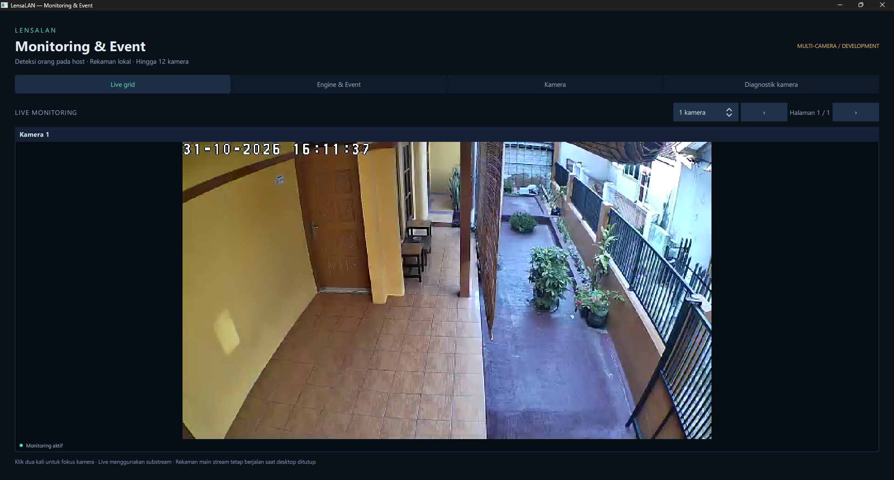
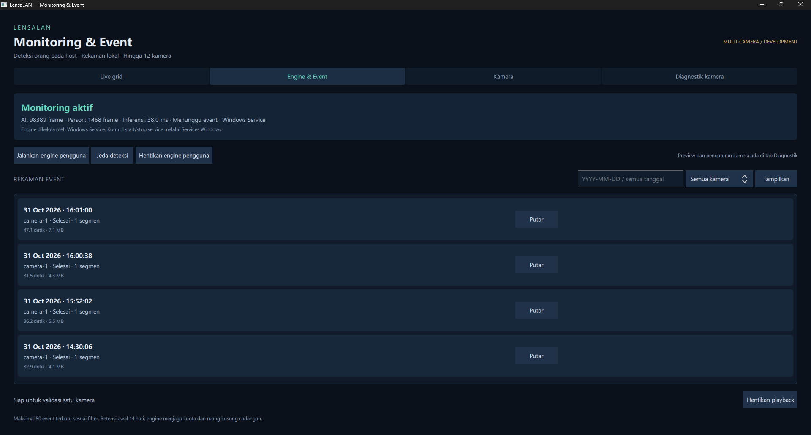
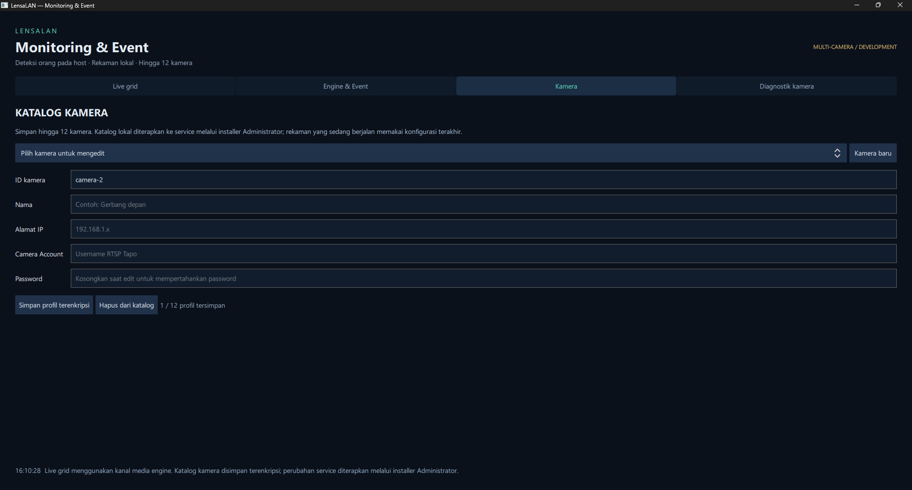
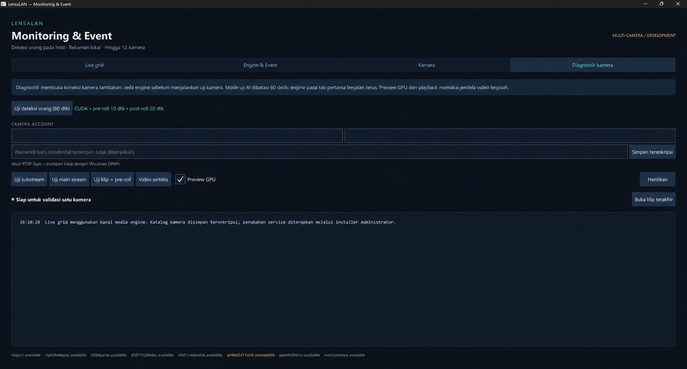

# LensaLAN

A native Windows desktop NVR for monitoring up to 12 IP cameras on a local network and recording events when the host detects a person.

LensaLAN is growing toward modular camera analytics, automation, and integrations. Implemented capabilities and validation results are kept separate from the [long-term product roadmap](docs/PRODUCT_VISION.md).

## Development status

The current implementation includes 1/4/9/12 live-grid layouts, an engine supporting up to 12 configured cameras, a shared CUDA inference scheduler, independent reconnect and recording workers, SQLite event indexing, retention, local IPC control, and event review/playback.

Twelve synthetic sources and all grid layouts have been tested. CUDA inference and live viewing have also been verified with one physical Tapo camera through the Windows Service. Performance with 12 physical RTSP cameras and a controlled 24-hour soak test remain unverified. This is development software, with further validation required before production use.

## Screenshots

The screenshots show the development build. The application UI is currently in Indonesian.

### Live monitoring

Live video is delivered by the engine without opening additional RTSP connections from the desktop. Grid layouts, pagination, and a focused camera view are available.



### Event monitoring and playback

Review recording status and filter events by date and camera, then play finalized event segments.



### Camera registration

Manage up to 12 encrypted camera profiles. Apply the local catalog to the service through the elevated installer.



### Diagnostics and maintenance

Test streams, person detection, and recording independently from normal monitoring. Camera IP and account values have been removed from this screenshot for publication.



## Architecture and reference hardware

The stack consists of **C++20, Qt 6/QML, GStreamer, ONNX Runtime CUDA, SQLite, and a Windows Service**.

The initial reference setup uses a TP-Link Tapo C520WS, Intel Core i5-12400F, NVIDIA RTX 3060 12 GB, and 16 GB DDR4 RAM. These are the development reference devices, not a guarantee of 12-camera performance.

The service owns camera connections, inference, recording, and storage. The desktop consumes status and media through local IPC. Closing the desktop does not stop the engine.

## Running the application

Prepare the development environment and build the application using the [build guide](docs/BUILD.md), then launch:

```powershell
.\LensaLAN.cmd
```

On a machine with the service installed, the desktop detects its configuration and connects to the engine in ProgramData. For development without an installed service, use **Start user engine** (`Jalankan engine pengguna`). The pause and stop controls manage detection and the user-mode engine; Windows Service start/stop is managed separately.

The **Live grid** tab displays the engine's substreams. Double-click a tile to focus on one camera, and use the layout selector or pagination to change views. An older service runtime must be upgraded to support the media channels used by the live grid.

The **Camera** tab (`Kamera`) stores encrypted profiles for up to 12 cameras. Catalog changes take effect in the service after applying them through the elevated installer. The **Diagnostics** tab (`Diagnostik kamera`) provides separate stream, detection, and recording probes.

## Local storage and validation

Development engine data lives in `.local/engine/`, including the event database, recordings, and encrypted credentials when provisioned. The initial retention policy is 14 days with a 100 GB quota and a free-space reserve. Earlier M0 clips in `.local/recordings/` remain separate and are not managed by the engine's retention policy.

The earlier service build passed camera/CUDA startup and person-event recording in Session 0; the user also confirmed a reboot test. The multi-camera 0.3.0-dev runtime has been deployed and tested with CUDA and live viewing from one physical camera. A controlled soak test, 12-camera hardware benchmarks, detection zones, clip export, and a complete desktop installer remain future work.

## Documentation

The linked project documents are currently primarily in Indonesian.

- [Product requirements](docs/PRD.md)
- [Development plan](docs/DEVELOPMENT_PLAN.md)
- [Product vision and roadmap](docs/PRODUCT_VISION.md)
- [Build and development setup](docs/BUILD.md)
- [Development log](docs/DEVELOPMENT_LOG.md)
- [M0 validation results](docs/validation/M0_FEASIBILITY.md)
- [M1 validation results](docs/validation/M1_ACCEPTANCE.md)
- [Windows Service installation](docs/SERVICE.md)
- [Multi-camera and live-grid validation](docs/validation/MULTICAMERA_LIVE_GRID.md)
- [Publication and local-data protection](docs/PUBLICATION.md)

## Compatibility names

The product and repository are named **LensaLAN**. Internal `opennvr` identifiers, the `OpenNVR` service name, legacy data paths, and `OPENNVR_*` environment variables are retained for compatibility with existing development deployments. The original launcher remains available as an alias.
